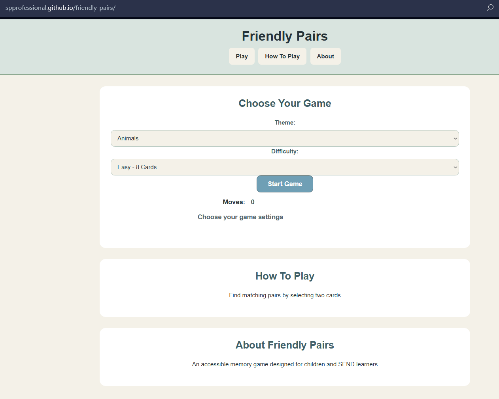
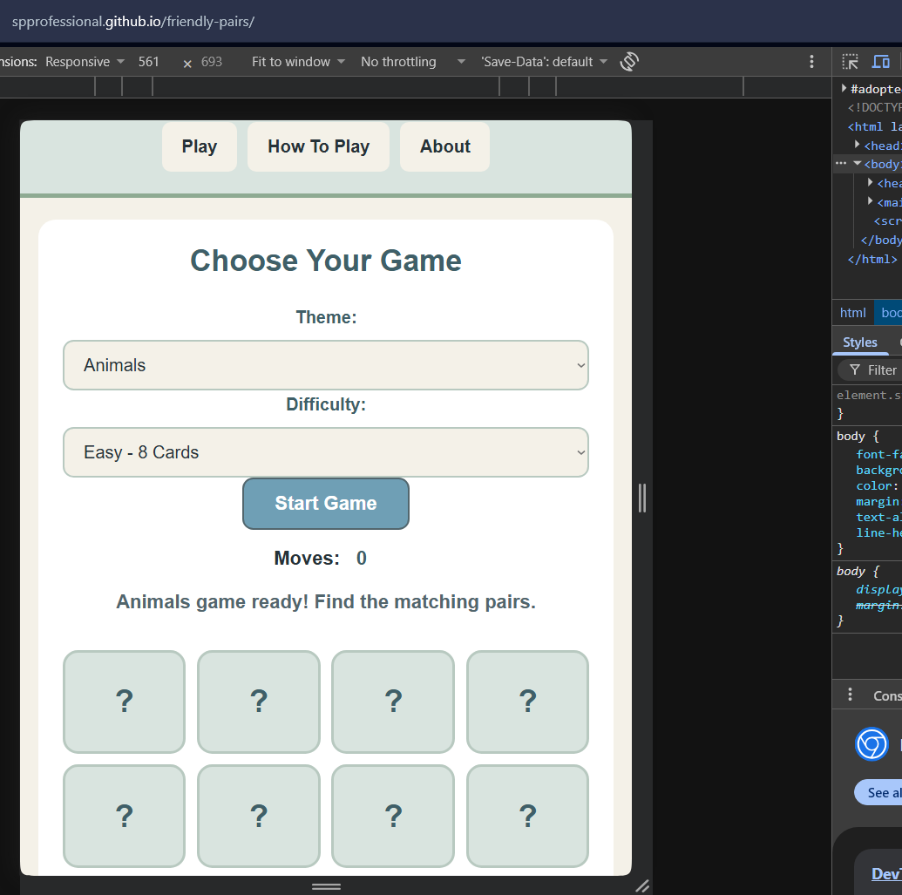

# UX Design Process

## Project Design Overview

Friendly Pairs was designed as a simple, accessible memory matching game for children. The main design priority was to create an interface that was easy to understand, visually welcoming and straightforward to navigate.

The application was developed with a focus on usability, accessibility and providing a positive experience for users with different levels of confidence and ability.

## Design Principles

The following principles guided the development of the application:

- **Simplicity:** Keep the interface clear and avoid unnecessary features or distractions.
- **Accessibility:** Provide clear labels, keyboard navigation, visible focus indicators and accessible status messages.
- **Consistency:** Use consistent buttons, spacing, typography and visual styling throughout the application.
- **Encouragement:** Provide clear feedback when cards are selected, pairs are matched and the game is completed.
- **Flexibility:** Allow users to select different themes and difficulty levels.
- **Responsive design:** Ensure the application remains usable on desktop, tablet and mobile screens.

## Colour and Visual Design

A calm, child-friendly colour palette was selected to create a welcoming environment without relying on overly bright or visually overwhelming colours.

The design aims to be suitable for a broad range of users, including children who may benefit from a predictable and less distracting interface.

Consistent styling is used across buttons, game cards and navigation elements to help users understand how to interact with the application.

## Reconstructed Low-Fidelity Wireframe

No formal wireframe was produced during the original development process. The following low-fidelity wireframe has therefore been reconstructed retrospectively to illustrate the intended structure and layout of the finished application.

+--------------------------------------+
|             FRIENDLY PAIRS           |
|                                      |
|       Play | How To Play | About     |
+--------------------------------------+
|                                      |
|       Welcome to Friendly Pairs      |
|                                      |
|       Choose your game settings      |
|                                      |
|       Theme: [ Select Theme ]        |
|                                      |
|       Difficulty: [ Select Level ]   |
|                                      |
|             [ START GAME ]           |
|                                      |
+--------------------------------------+
|                                      |
|          GAME PROGRESS               |
|                                      |
|            Moves: 0                  |
|                                      |
|       +-------+   +-------+          |
|       | Card  |   | Card  |          |
|       +-------+   +-------+          |
|       +-------+   +-------+          |
|       | Card  |   | Card  |          |
|       +-------+   +-------+          |
|                                      |
+--------------------------------------+
|              HOW TO PLAY             |
|                                      |
|       Instructions for playing       |
|                                      |
+--------------------------------------+
|                 ABOUT                |
+--------------------------------------+

This wireframe represents the main content hierarchy: navigation, game configuration, the game area and supporting information.

## Design Decisions and User Experience

Several decisions were made to make the game approachable and predictable:

- Three themes were included: Animals, Numbers and Colours, giving users a choice of visual content.
- Three difficulty levels were provided, allowing users to select a suitable challenge.
- A move counter provides feedback on progress without introducing time pressure.
- Matched cards remain visible, while incorrect selections are turned back over.
- Completion feedback provides a clear indication that the game has been finished.
- A reset option allows users to start another game.
- Keyboard accessibility and visible focus indicators support users who do not navigate using a mouse.
- Reduced-motion preferences are respected to avoid unnecessary animation.
- The responsive layout allows the game to adapt to smaller screens.

## From Design to Final Application

Although the original development did not include a formal wireframing stage, the reconstructed wireframe demonstrates the structure that informed the finished interface.

During development, the layout was refined through implementation and testing. The final application includes the planned navigation, game configuration controls, card grid and supporting instructions.

The finished version also incorporates accessibility and usability improvements, including keyboard interaction, accessible feedback, responsive styling and clear visual states.

The following screenshots demonstrate how the design translates into the completed application:

### Desktop Layout

### Responsive Mobile Layout

## Conclusion

The design process prioritised clarity, accessibility and ease of use. While formal wireframes were not created before development, the reconstructed wireframe and supporting explanation demonstrate the application's layout, design principles and the reasoning behind its final user experience.